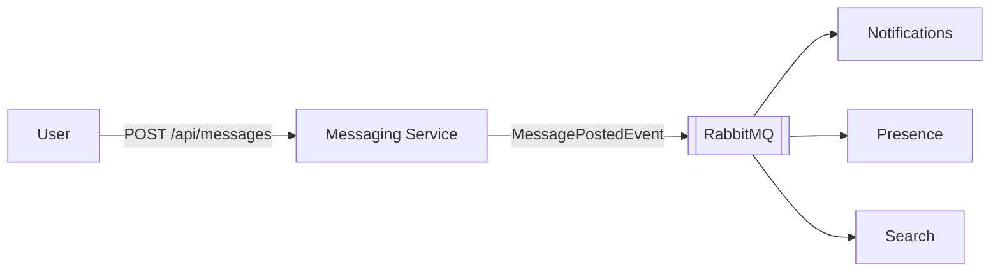

# Analysis and design

Bizcord is a Discord-like chat app. Each team builds one microservice, which owns one bounded context. This repository is the **Messaging Service**.

## Domains

| Context | Responsibility | Owns |
|---|---|---|
| **Messaging** | Posting, editing, deleting and listing messages in channels | Messages |
| Channels | Creating channels and managing their members | Channels, memberships |
| Users | User profiles | Profiles |
| Notifications | Telling users about mentions and replies | Notifications |
| Presence | Who is online and when they were last active | Last-active times |
| Search | Finding messages by their content | The search index |

## The Messaging Service

**Responsible for:** posting, editing, deleting and listing messages, and telling other services when a message is posted.

**Not responsible for:** checking that a channel or author exists (Channels and Users own those), or sending notifications and indexing messages (the services that react to new messages do that).

**Data ownership:** it is the only service that stores or changes messages, and other services never read its data directly. A message refers to its channel and author by id only, because those belong to other services. Other services only see the shared model in `packages/Shared.Contracts` (`MessageDto` and `MessagePostedEvent`). Internal details, such as when a message was last edited, stay inside the service.

## Interactions

- **REST API (synchronous):** other services create, read, update and delete messages at `/api/messages`.
- **Events (asynchronous):** when a message is posted, the service publishes `MessagePostedEvent` to RabbitMQ. It doesn't know or wait for who reacts.

Posting succeeds even if a consumer is down. The event waits in that consumer's queue, so it catches up a little later (eventual consistency).
